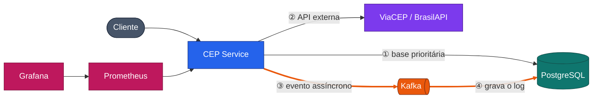

# CEP Service

Serviço de busca de CEP em **Java 21 + Spring Boot 3**, com:

- **Busca em API externa** (ViaCEP, com BrasilAPI como contingência);
- **Base de endereços prioritários**: um endereço cadastrado é devolvido antes de consultar a API externa;
- **Log de cada consulta** (horário e dados retornados) gravado no PostgreSQL de forma **assíncrona, via Kafka**, para não afetar o tempo de resposta;
- **Proteção contra SQL Injection**, **tratamento de exceções seguro** e princípios **SOLID**;
- **Monitoramento** com Prometheus e **gráficos** no Grafana;
- Tudo sobe com **Docker Compose**.

A arquitetura completa, com diagramas, está em [docs/arquitetura.md](docs/arquitetura.md).



## Como executar

Pré-requisito: Docker com Docker Compose.

```bash
docker compose up --build
```

| Serviço | Endereço |
|---|---|
| API | http://localhost:8080 |
| Swagger UI (documentação e testes da API) | http://localhost:8080/swagger-ui.html |
| Grafana (dashboard "CEP Service") | http://localhost:3000 (admin / admin) |
| Prometheus | http://localhost:9090 |
| Kafka UI (ver as mensagens do tópico) | http://localhost:8081 |

Para rodar só os testes: `mvn test` (Java 21 e Maven 3.9+).

## Endpoints

| Método | Rota | Descrição |
|---|---|---|
| `GET` | `/api/v1/ceps/{cep}` | Busca o CEP: base prioritária primeiro, depois a API externa |
| `POST` | `/api/v1/addresses` | Cadastra um endereço prioritário |
| `GET` | `/api/v1/addresses?city=` | Lista os endereços prioritários (filtro opcional por cidade) |
| `GET` | `/api/v1/addresses/{cep}` | Consulta um endereço prioritário |
| `DELETE` | `/api/v1/addresses/{cep}` | Remove um endereço prioritário |
| `GET` | `/api/v1/lookups?cep=` | Últimas 50 consultas gravadas no log |

Exemplos prontos em [requests.http](requests.http) e no roteiro [scripts/demo.sh](scripts/demo.sh).

```bash
# Busca na API externa
curl http://localhost:8080/api/v1/ceps/01001-000

# Cadastra um endereço prioritário para o mesmo CEP
curl -X POST http://localhost:8080/api/v1/addresses \
  -H "Content-Type: application/json" \
  -d '{"cep":"01001-000","street":"Praça da Sé","complement":"Sede","neighborhood":"Sé","city":"São Paulo","state":"SP"}'

# Agora a busca devolve o endereço da base prioritária ("source": "PRIORITY_BASE")
curl http://localhost:8080/api/v1/ceps/01001-000

# Log das consultas, gravado de forma assíncrona
curl "http://localhost:8080/api/v1/lookups?cep=01001000"
```

## Como cada requisito foi atendido

### Busca em API externa
`ViaCepProvider` consulta a ViaCEP com timeout de conexão e de leitura. Se ela falhar, o
`FallbackCepProvider` tenta a `BrasilApiProvider`. Um CEP inexistente devolve `404`; os dois
provedores fora do ar devolvem `503` com mensagem genérica.

### Endereços prioritários
`CepLookupService` consulta primeiro a tabela `priority_address`. Só se o CEP não estiver lá
a API externa é chamada. A resposta informa a origem no campo `source`.

### Proteção contra SQL Injection
Defesa em camadas:
1. **Consultas parametrizadas em todo o acesso a dados** (métodos do Spring Data e JPQL com
   parâmetros nomeados). Nenhuma consulta é montada por concatenação de strings. Esta é a
   proteção principal.
2. **Validação por allowlist na entrada**: o CEP só aceita 8 dígitos (value object `Cep`);
   os textos só aceitam letras, números e pontuação de endereço; a UF é validada contra a
   lista das 27 unidades federativas.
3. **Higienização** (`TextSanitizer`): normalização Unicode, remoção de caracteres de controle
   e de espaços repetidos.
4. **Restrições no banco**: `CHECK` no formato do CEP, `UNIQUE` e tamanhos máximos.

O apóstrofo é aceito de propósito ("Rua D'Ávila"), o que mostra que a segurança vem da
parametrização, e não de bloquear caracteres. Há testes para os dois casos em `ApiSecurityTest`.

### Log assíncrono das consultas
A cada busca, `CepLookupService` publica um `CepLookupEvent` (horário da consulta, origem e
dados retornados) no tópico `cep-lookups`, sem esperar a confirmação do broker. O
`LookupLogConsumer` consome o evento e grava em `cep_lookup_log`.
- **Idempotência**: o `event_id` é único no banco; reentregas do Kafka não duplicam o log.
- **Resiliência**: falha ao gravar tem 3 novas tentativas; depois disso a mensagem vai para o
  tópico `cep-lookups-dlt`, sem travar a fila.
- **A busca nunca falha por causa do log**: se a publicação falhar, a resposta segue e a falha
  vira métrica (`cep_lookup_events_publish_failures_total`).

### SOLID

| Princípio | Onde aparece |
|---|---|
| **S**ingle Responsibility | Controllers só traduzem HTTP; casos de uso só têm regra; adaptadores só falam com uma tecnologia |
| **O**pen/Closed | Novo provedor de CEP = nova classe que implementa `CepProvider`, sem alterar o caso de uso |
| **L**iskov Substitution | `ViaCepProvider`, `BrasilApiProvider` e `FallbackCepProvider` são intercambiáveis pelo mesmo contrato |
| **I**nterface Segregation | Portas pequenas e específicas: `CepProvider`, `LookupEventPublisher`, `LookupMetrics`... |
| **D**ependency Inversion | Os casos de uso dependem de interfaces; JPA, Kafka e HTTP ficam nos adaptadores |

### Tratamento de exceções sem expor a aplicação
O `GlobalExceptionHandler` devolve respostas no padrão RFC 7807 (`application/problem+json`):
- erros de negócio têm mensagem clara (CEP inválido, não encontrado, já cadastrado);
- erros de validação listam o campo e a regra, **sem repetir o valor enviado**;
- erros inesperados devolvem só um **código de referência**; o detalhe técnico fica apenas no
  log do servidor;
- stack trace, mensagens internas e nomes de classes nunca são expostos
  (`server.error.include-* = never`).

### Monitoramento e gráficos
O Actuator expõe métricas em `/actuator/prometheus`; o Prometheus coleta a cada 5s e o
Grafana já sobe com o dashboard **CEP Service**, que mostra:
- consultas por resultado (base prioritária, ViaCEP, BrasilAPI, não encontrado, falha);
- latência p50/p95 da busca e latência p95 de cada provedor externo;
- respostas HTTP por status;
- logs gravados e falhas de publicação no Kafka;
- memória da JVM;
- **Kafka**: mensagens produzidas x consumidas, lag do consumidor por partição, tempo de
  envio e de processamento, e erros/mensagens desviadas para a DLT. Essas métricas vêm
  dos próprios clientes Kafka, publicadas pelo Micrometer, sem exporter adicional.

Para gerar tráfego e ver os gráficos se mexerem: `./scripts/load.sh`.

### Teste de carga (15 minutos)

Executado localmente em 18/10/2026, com a stack completa no Docker Compose (uma instância de
cada serviço, numa máquina de desenvolvimento).

**Cenário.** Três cópias de `./scripts/load.sh 900` em paralelo (~14,5 requisições/s). Os 8 CEPs
válidos da lista foram cadastrados antes na base prioritária, para não sobrecarregar as APIs
públicas, que são gratuitas; cada busca continua gerando um evento no Kafka. Ficaram de fora
o CEP inexistente `00000000`, que passa pela ViaCEP e pela BrasilAPI, e o CEP inválido `abc`,
recusado na validação.

| Métrica | Resultado |
|---|---|
| Requisições enviadas | 13.055 em 900 s (14,5/s) |
| Buscas válidas (200 + 404) | 11.760: 10.491 encontradas e 1.269 inexistentes |
| Requisições inválidas (400) | 1.295, recusadas antes de qualquer consulta |
| Eventos publicados no Kafka / logs gravados no banco | 11.760 / 11.760 (nenhum perdido) |
| Falhas de publicação, mensagens na DLT, erros do consumidor | 0 / 0 / 0 |
| Lag máximo do consumidor | 0 mensagens (coleta a cada 5 s) |
| Envio ao Kafka (média) / gravação do log (média, máximo) | 1,4 ms / 3,7 ms, 227 ms |
| Latência da busca encontrada (base prioritária) | p95 = 3,1 ms (máximo 589 ms) |
| Latência da busca inexistente (APIs externas) | p95 = 463 ms com a ViaCEP no ar; 2,1 s depois que ela caiu |
| Heap máximo da JVM | ~120 MB |

**Leitura dos resultados.**
- **O log assíncrono não pesa na resposta.** A busca na base prioritária responde em poucos
  milissegundos, e a publicação no Kafka leva ~1,4 ms. A gravação no banco acontece depois,
  no consumidor, que acompanhou o ritmo o tempo todo (lag zero) sem perder nenhum evento.
- **O fallback funcionou numa falha real.** Aos ~8 minutos de teste, a ViaCEP deixou de
  responder por IPv4 a partir da máquina do teste ("Host is unreachable" e "Connect timed out",
  534 avisos no log). Não foi possível saber se foi um bloqueio por volume ou uma
  instabilidade deles. Todas essas buscas seguiram para a BrasilAPI e responderam
  corretamente, sem nenhum erro 5xx. O custo apareceu só na latência das buscas que dependiam
  da API externa, que passou a incluir o timeout de conexão de 2 s.
- **As partições ficaram desbalanceadas** (56%, 22% e 22% das mensagens), porque a chave da
  mensagem é o CEP e o teste usa só 10 CEPs. Com CEPs variados, como em produção, a
  distribuição tende a se equilibrar.

**Possíveis melhorias que o teste sugere:** cache das respostas das APIs externas (um CEP
quase nunca muda) e circuit breaker, para deixar de tentar a ViaCEP por um tempo depois de
falhas seguidas, em vez de pagar o timeout em toda requisição.

## Estrutura do projeto

```
src/main/java/com/thalesoliveira/cep
├── api/              controllers, DTOs com validação, tratamento de exceções
├── application/      casos de uso e portas (interfaces)
├── domain/           modelo (Cep, Address), evento e exceções de negócio
└── infrastructure/   adaptadores: JPA, ViaCEP/BrasilAPI, Kafka, métricas
```

## Testes

- `CepTest`: formatos aceitos e entradas maliciosas rejeitadas;
- `CepLookupServiceTest`: prioridade da base local, fallback, log mesmo quando não encontra,
  busca segue funcionando com o Kafka fora do ar;
- `PriorityAddressServiceTest`: higienização, duplicidade, UF inválida;
- `LookupLogServiceTest`: idempotência do consumidor;
- `FallbackCepProviderTest`: contingência entre provedores;
- `ApiSecurityTest`: SQL Injection barrado, apóstrofo aceito como dado, erros sem vazamento.

## Uso de IA no desenvolvimento

O projeto foi desenvolvido com apoio de IA generativa (Claude), usada para acelerar a escrita
do código, dos testes e da documentação. As decisões de arquitetura, a revisão do código e a
validação do funcionamento foram feitas por mim.

## Próximos passos

- Padrão *transactional outbox*, para não perder eventos se o Kafka estiver fora do ar;
- Testes de integração com Testcontainers (PostgreSQL e Kafka reais);
- Cache das consultas externas (Redis) e circuit breaker (Resilience4j);
- Autenticação (OAuth2/JWT) nos endpoints de escrita e rate limiting;
- Publicação em cloud pública com pipeline de deploy.
