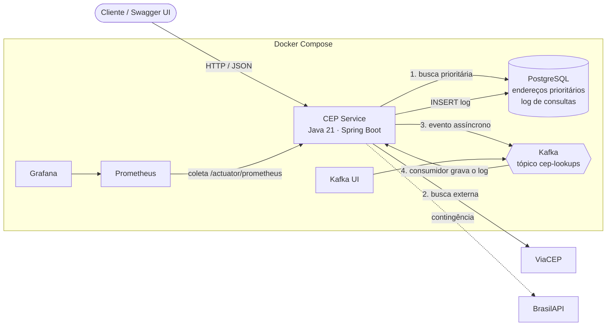
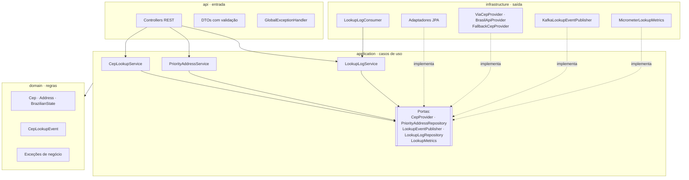
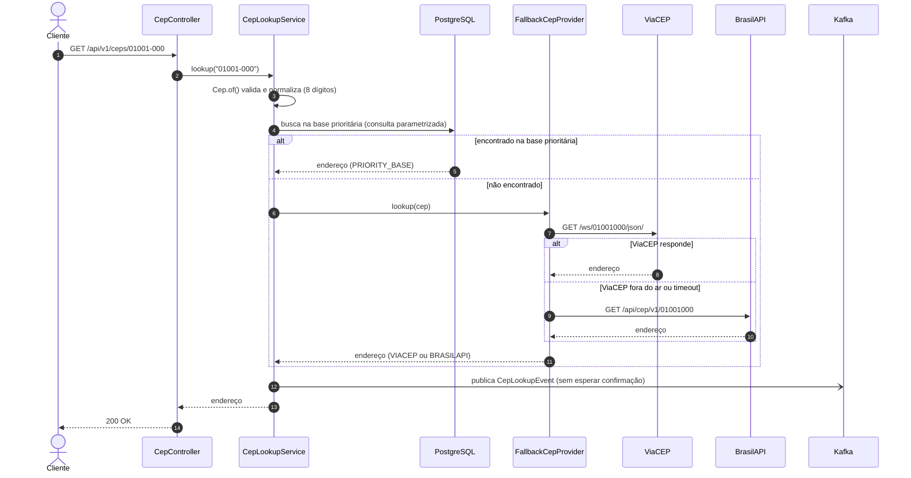
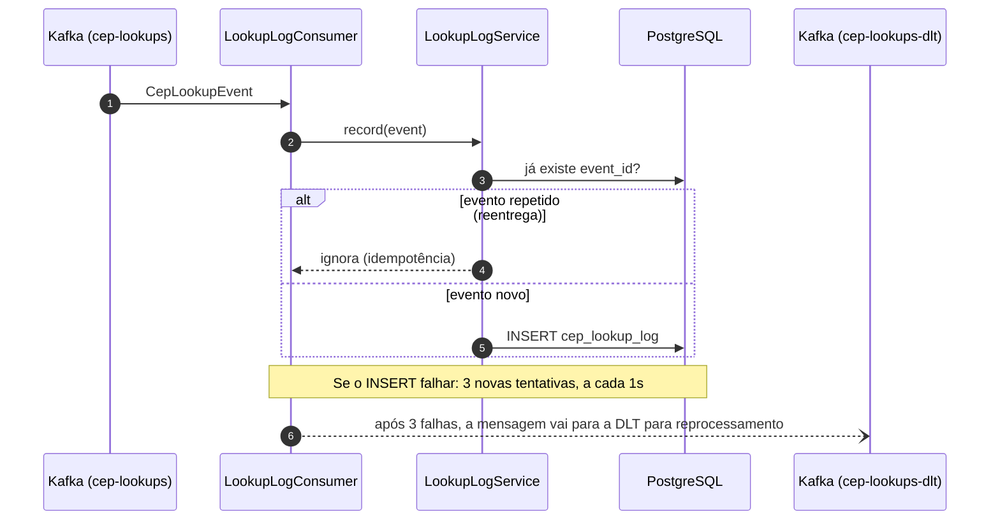
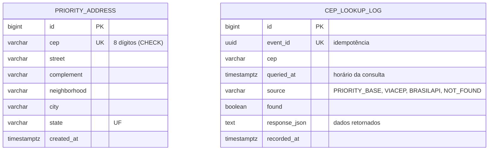

# Arquitetura do CEP Service

Os diagramas estão em Mermaid; o GitHub os mostra como imagem.

## 1. Visão geral (contexto e containers)

## 2. Camadas (portas e adaptadores)

O caso de uso não conhece Spring Data, Kafka nem HTTP: depende só de interfaces (portas).
Cada tecnologia fica num adaptador que implementa uma porta.

## 3. Fluxo da busca de CEP

## 4. Fluxo do log assíncrono

## 5. Modelo de dados

## 6. Decisões e trade-offs

| Decisão | Motivo | Trade-off |
|---|---|---|
| Log via Kafka, fora da requisição | A gravação do log não soma latência à resposta | O log é eventualmente consistente (aparece alguns milissegundos depois) |
| `max.block.ms = 2s` no produtor | Se o Kafka cair, a requisição não fica presa os 60s padrão | Com o Kafka fora, o evento se perde; a falha é contada em métrica |
| Consumidor idempotente (`event_id` único) | O Kafka entrega "pelo menos uma vez"; reentregas não duplicam o log | Uma consulta a mais no banco por evento |
| Retentativas + DLT | Falha temporária do banco não perde eventos nem trava a fila | Exige monitorar a DLT |
| Dois provedores com fallback | ViaCEP fora do ar não derruba o serviço | Formatos diferentes de resposta a mapear |
| Validação por allowlist + consultas parametrizadas | Defesa em camadas contra SQL Injection | Regras de caracteres precisam acompanhar casos reais (ex.: apóstrofo) |

**Evolução natural:** para garantir que nenhum log se perca mesmo com o Kafka fora do ar, o próximo passo seria o padrão *transactional outbox* (gravar o evento numa tabela local e publicar a partir dela).
